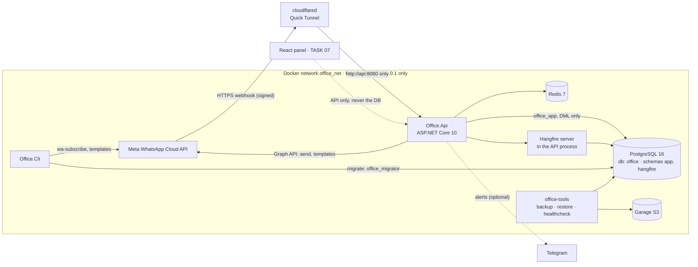

# Architecture (DECISIONS v1.1)

## Request flow (inbound)

1. Meta → `POST /webhooks/whatsapp`. The API reads the raw body (≤ 1 MB) and verifies
   `X-Hub-Signature-256` (HMAC-SHA256, constant-time). Bad or missing signature → **401**, nothing stored.
2. Each `entry[].changes[]` is stored as one row in `app.wa_webhook_events` (canonical JSON, unique SHA-256).
   Duplicate deliveries hit the unique index and are dropped.
3. One Hangfire job per new event is queued and the API answers **200** (no external calls in the request).
4. `ProcessEventAsync` (3 retries, alert after the last) runs `EventProcessor` in one transaction:
   inbound messages (`pending`, or `ignored_group`), the 24-hour window, delivery statuses (forward only),
   template status updates.
5. TASK 03 continues from `wa_inbound_messages` rows in `pending`.

## Sending

`MessageSender` (Core) → `IWhatsAppStore` + `IWhatsAppCloudApi`:
idempotency key (unique) → 24-hour window for free-form messages → approved templates only →
Graph API call → result recorded. Retries happen only on 429/502/503/504 and connection failures,
never after a timeout, so a message is never sent twice.

## Rules for modules

- `Office.Core` holds rules and use cases and depends on nothing (an architecture test enforces it).
- Infrastructure implements Core interfaces; the API and CLI only wire things together.
- Database constraints (unique indexes, CHECKs) back up every rule that matters (T-19).
- Business rules live in C#. The database only keeps them from being broken twice.
- n8n and Appsmith are not part of v1 (T-22, T-11).
