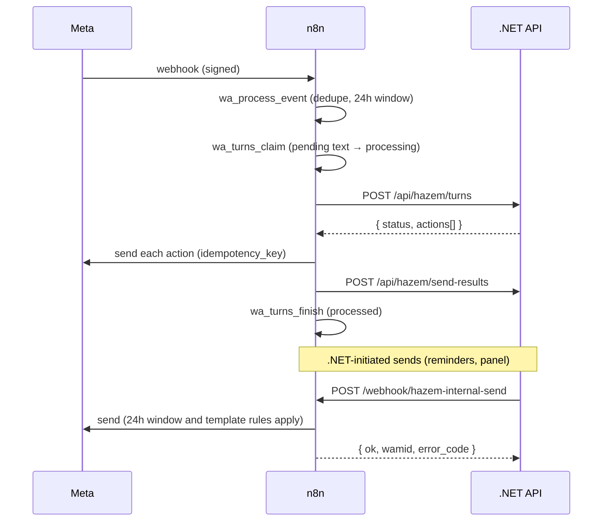

# Internal API between n8n and the .NET backend (DECISIONS v1.3, T-17 to T-20)

n8n is the WhatsApp layer (the only thing that talks to Meta); the .NET API is the brain.
They talk only inside the Docker network `office_net`.



## Authentication

| Direction | Header | Secret in `.env` | n8n credential |
|---|---|---|---|
| n8n → .NET | `X-Hazem-Token` | `HAZEM_API_TOKEN` | `hazem-api` (Header Auth) |
| .NET → n8n | `X-Hazem-Token` | `N8N_INTERNAL_SEND_TOKEN` | `hazem-internal-send` (Header Auth on the Webhook node) |

- Two different secrets, at least 32 characters each (preflight refuses anything else).
- .NET compares in constant time and answers `401` without a body detail.
- n8n is reachable from the internet through the tunnel, so its internal webhook is protected
  **only** by the header. The .NET API has no host port and is never behind the tunnel.

## n8n → .NET

Base URL: `http://api:8080`.

### `POST /api/hazem/turns`

One *turn* = what the client said that needs one answer. Until TASK 03 (8-second grouping,
media, voice) a turn is one text message and `turn_id` is `wa:<wamid>`.

```json
{
  "turn_id": "wa:wamid.HBgM...",
  "wa_id": "201001234567",
  "contact_name": "Client name from WhatsApp",
  "messages": [
    {
      "wamid": "wamid.HBgM...",
      "type": "text",
      "text": "عايز أحجز استشارة",
      "sent_at": "2026-10-20T10:15:00+03:00",
      "context_wamid": null
    }
  ]
}
```

| Field | Rule |
|---|---|
| `turn_id` | required, 1–200 characters, unique per turn |
| `wa_id` | required, 8–15 digits |
| `messages` | 1–50 items, each with `wamid` and `type`; `text` up to 4096 characters |

Response `200`:

```json
{
  "turn_id": "wa:wamid.HBgM...",
  "status": "processed",
  "actions": [
    {
      "type": "send_text",
      "text": "…",
      "idempotency_key": "hazem:wa:wamid.HBgM...:0",
      "context_wamid": "wamid.HBgM..."
    },
    {
      "type": "send_template",
      "template_name": "reminder_day_before",
      "language": "ar",
      "components": [],
      "idempotency_key": "hazem:wa:wamid.HBgM...:1"
    }
  ]
}
```

- `status` is `processed` the first time and `duplicate` when the same `turn_id` comes again;
  a duplicate returns **the same actions** so n8n can safely finish a turn it lost half-way
  (the idempotency keys stop anything from being sent twice).
- `actions` may be empty (nothing to send).
- `400`: invalid request (problem details). n8n marks the messages `failed` and logs the error.
- `401`: missing or wrong token.
- `5xx` or no answer: n8n puts the messages back to `pending` and retries the next minute.

### `POST /api/hazem/send-results`

What happened to each action n8n tried to send.

```json
{
  "turn_id": "wa:wamid.HBgM...",
  "results": [
    {
      "idempotency_key": "hazem:wa:wamid.HBgM...:0",
      "ok": true,
      "outbound_id": "0b9c…",
      "wamid": "wamid.HBgN...",
      "status": "sent",
      "error_code": null,
      "error_message": null
    }
  ]
}
```

Response `200`: `{ "recorded": 1 }`. Recording the same key again updates it (idempotent).
Error codes are the ones in [whatsapp-integration.md](whatsapp-integration.md#error-codes).

## .NET → n8n

### `POST http://n8n:5678/webhook/hazem-internal-send`

```json
{ "type": "send_text", "wa_id": "201001234567", "text": "…",
  "idempotency_key": "reminder:appointment-42:day-before", "requested_by": "hazem-api" }
```

or

```json
{ "type": "send_template", "wa_id": "201001234567", "template_name": "reminder_day_before",
  "language": "ar", "components": [], "idempotency_key": "…", "requested_by": "hazem-api" }
```

Response `200` (always, the outcome is in the body):

```json
{ "ok": true, "outbound_id": "…", "wamid": "wamid…", "status": "sent", "error_code": null, "error_message": null }
```

- Same rules as any other send: 24-hour window for text, `APPROVED` templates only, and the
  same `idempotency_key` never sends twice (the first result is returned with `DUPLICATE`
  when it had not succeeded).
- Wrong or missing token: `403` from n8n, nothing is sent.
- Because of the idempotency key, .NET may retry a call that timed out.

## Who owns what

| | n8n (`office_app`) | .NET (`office_api`) |
|---|---|---|
| Schema `app` (`wa_*`, `settings`) | read/write | **no access** |
| Schema `hazem` (turns, send results, business tables) | **no access** | read/write |
| Meta Graph API | only caller | never |
| Business decisions | never | only place |

## Message states in `app.wa_inbound_messages`

`pending` → `processing` (claimed by `app.wa_turns_claim`) → `processed` / `failed`
(`app.wa_turns_finish`). A row left in `processing` for more than 5 minutes is claimed again.
Until TASK 03 only `text` messages are forwarded; media stays `pending` for TASK 03.

## Testing without Meta

- `whatsapp.dry_run = true` in `app.settings`: sends are recorded as `sent` with a fake
  `wamid.DRYRUN-…` and Meta is never called. Keep it `false` (the healthcheck fails otherwise).
- `echo.enabled = true` and `echo.recipients` in `hazem.settings`: the API answers every text
  turn from those numbers with «تم استلام رسالتك (اختبار) ✅». Off by default.
- `hazem-e2e` (scripts) runs the whole loop with dummy numbers and both switches, then turns them off.
