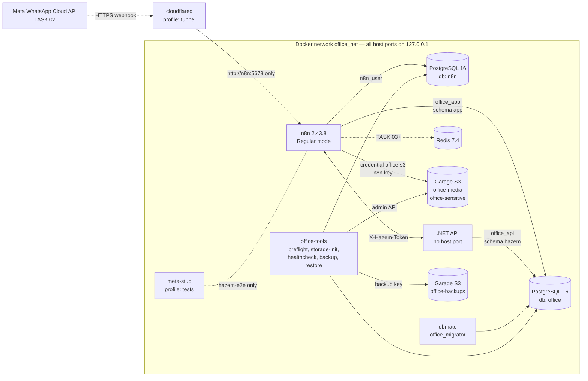

# Infrastructure (TASK 01, updated for DECISIONS v1.3) — Test/Staging

Reference: [DECISIONS-v1.3.md](decisions/DECISIONS-v1.3.md) — T-01 to T-06, T-09, T-11 to T-13, T-15 to T-22.
n8n is the WhatsApp layer; the .NET API is the brain ([hazem-internal-api.md](hazem-internal-api.md)).

## Components

Startup order: `preflight` → `postgres`, `redis`, `garage` → `storage-init` → `n8n`; `api` starts
once `postgres` is healthy (its `/health/ready` also needs migration 0003).
`preflight` and `storage-init` are one-shot jobs; everything else restarts `unless-stopped`.

## PostgreSQL roles and privileges

| Role | Database | Can do | Cannot do | Used by |
|---|---|---|---|---|
| `postgres_admin` (superuser) | all | everything | — | init script, backup, restore, healthcheck only |
| `n8n_user` | `n8n` (owner) | n8n internal tables | connect to `office` | n8n |
| `office_migrator` | `office` (owner) | DDL, owns schema `app` | connect to `n8n` | dbmate migrations only |
| `office_app` | `office` | `SELECT, INSERT, UPDATE, DELETE` on tables in `app`; sequences; the `app.wa_*` functions | `CREATE` anything; any access to schema `hazem`; connect to `n8n` | n8n workflows |
| `office_api` | `office` | `SELECT, INSERT, UPDATE, DELETE` on tables in `hazem` | `CREATE` anything; any access to schema `app`; connect to `n8n` | .NET API |
| `office_readonly` | `office` | `SELECT` | any write; connect to `n8n` | reports, Appsmith read views |

- `CONNECT` is revoked from `PUBLIC` on `n8n`, `office` and `postgres`.
- Default privileges: every table or sequence `office_migrator` creates later is granted to
  `office_app` and `office_readonly` automatically; in schema `hazem` (migration 0003) to
  `office_api` instead. `office_app` has no `USAGE` on `hazem` and `office_api` none on `app`,
  so each role is kept out of the other's tables by the database itself.
- `office_app` and `office_readonly` use `search_path = app, public`, `office_api` uses
  `search_path = hazem, public`; all use timezone `Africa/Cairo`.
- Server timezone: `Africa/Cairo`.
- Extensions installed by migration 0001: `pgcrypto`, `citext`.

## Object storage

T-06 asked for MinIO in test. **MinIO no longer publishes container images**, so the test
environment uses **Garage** instead: open source, S3-compatible, per-key bucket permissions
and lifecycle expiry. Production stays on **Cloudflare R2** (T-06). The n8n S3 credential
only needs its endpoint and keys changed.

| Bucket | Content | Access |
|---|---|---|
| `office-media` | voice notes, videos, stickers (TASK 03) | n8n key: read + write |
| `office-sensitive` | every image and document from clients (TASK 03): they may be ID cards, Urfi documents, receipts or contracts | n8n key: read + write |
| `office-backups` | PostgreSQL dumps, expire after 30 days | backup key: read + write + owner |

| Access key | `office-media` | `office-sensitive` | `office-backups` |
|---|---|---|---|
| n8n (`S3_N8N_ACCESS_KEY_ID`) | read, write | read, write | none |
| backup (`S3_BACKUP_ACCESS_KEY_ID`) | none | none | read, write, owner |

- No bucket has website/public access, and anonymous requests are rejected.
- Keys are imported from `.env`, so they stay the same after a rebuild.
- The Garage admin API (port 3903) is reachable only inside `office_net`.

**Differences from the original T-06 wording:**
- **No object versioning or object lock.** Garage does not support them. Protection in
  test comes from the separate bucket, least-privilege keys and the daily database backup.
  R2 behaves the same way, so production design must not depend on versioning either.
- **No web console.** Inspect buckets with
  `docker compose run --rm tools aws --endpoint-url http://garage:3900 --region garage s3 ls`
  (with the right keys set), or with the healthcheck.

### Sensitive files and AI (T-09)

Anything in `office-sensitive` — ID cards, Urfi documents, receipts — **must never be sent to
any AI provider** (OpenAI or other). Workflows in later tasks:
- store these files only in `office-sensitive`;
- never pass their binary data, URLs or extracted text to an AI node;
- send the AI only the text messages it needs for intent classification (T-07).

TASK 03: n8n writes the files (credential `office-s3`, created by `n8n-import` from
`S3_N8N_*`) under `wa/<yyyy>/<mm>/<media row id>.<ext>` — never a phone number, name, wamid or
original file name. The API has no S3 key: it only receives the bucket and key
([hazem-internal-api.md](hazem-internal-api.md)). Rules: [whatsapp-integration.md](whatsapp-integration.md#media-buckets-task-03-fixed-safety-rule-not-a-business-decision).

## Network exposure

- Every published port is bound to `127.0.0.1`.
- Only n8n can be reached from the internet, and only through cloudflared (profiles `tunnel`
  or `tunnel-named`), which forwards to `http://n8n:5678` and nothing else.
- `meta-stub` (profile `tests`, test only) has no published port and runs only during `hazem-e2e`.
- The .NET API has **no** published port: only n8n (and the tools container) reach it, at
  `http://api:8080` inside `office_net`. n8n's internal webhook `hazem-internal-send` is reachable
  through the tunnel like any n8n webhook, so it is protected by the `X-Hazem-Token` header.
- Create the n8n owner account before starting any tunnel.

## Moving to production (documentation only, not implemented)

| Test | Production |
|---|---|
| Docker Desktop on Windows or a small isolated VPS | Dedicated VPS (decided after testing, T-01) |
| Garage | Cloudflare R2, with separate buckets and scoped API tokens |
| Quick/Named Tunnel | Real domain with HTTPS, e.g. `bot.<domain>` and `panel.<domain>` (T-13) |
| `ENVIRONMENT=test` | `ENVIRONMENT=production`, separate `.env` and credentials |
| `N8N_SECURE_COOKIE=false` | `true` |
| Backups on Garage | Backups on R2 + regular restore drills |
