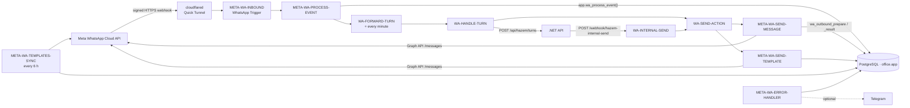

# WhatsApp integration (TASK 02, n8n) — DECISIONS v1.3

n8n is the WhatsApp layer: the only part that talks to Meta. Business decisions belong to the
.NET API ([hazem-internal-api.md](hazem-internal-api.md)). Every rule that must hold (dedupe, 24-hour window, status order,
idempotent sending, template approval) lives in PostgreSQL functions in migration
`0002_whatsapp.sql`, so it runs in one transaction and is tested without Meta.

## Workflows (`n8n/workflows/`, imported with `n8n-import`)

| Workflow | Trigger | What it does |
|---|---|---|
| `META-WA-INBOUND` | WhatsApp Trigger | Verifies `X-Hub-Signature-256` with the App Secret, answers Meta's GET verification, registers the webhook when published. Thin: hands every event to PROCESS-EVENT. **One per Meta App.** |
| `META-WA-PROCESS-EVENT` | sub-workflow | Calls `app.wa_process_event(event)`: stores the event (dedupe by hash), messages (dedupe by `wamid`, `pending`; groups `ignored_group`), 24-hour window, delivery statuses (forward only), template status. No media download (TASK 03). |
| `META-WA-SEND-MESSAGE` | sub-workflow | Input `wa_id, text, idempotency_key, requested_by[, context_wamid]` → `{ ok, outbound_id, wamid, status, error_code, error_message }`. |
| `META-WA-SEND-TEMPLATE` | sub-workflow | Input `wa_id, template_name[, language=ar][, components], idempotency_key, requested_by` → same output. |
| `CFG-GET` | sub-workflow | Returns `app.settings` as `cfg`; stops if a required key is empty. |
| `META-WA-TEMPLATES-SUBMIT` | manual | Syncs, then submits the M-03 templates Meta does not have. Never resubmits or deletes. |
| `META-WA-TEMPLATES-SYNC` | every 6 h / manual / called | Pulls template status and category into `app.wa_templates`. |
| `META-WA-SUBSCRIPTION-CHECK` | manual | Shows the app's callback URL and fields; subscribes the WABA to the app if missing. Used by `tunnel-refresh`. |
| `META-WA-SUBSCRIPTION-DELETE` | manual | Deletes the app's webhook subscription. Used by `tunnel-refresh` / `tunnel-down`. |
| `META-WA-ERROR-HANDLER` | error workflow | Logs every failure to `app.workflow_errors` (long digit runs masked); Telegram nodes are disabled until `ops-telegram` exists. |
| `WA-FORWARD-TURN` | after INBOUND / every minute / manual | Claims waiting text messages (`app.wa_turns_claim`, max 20) and runs WA-HANDLE-TURN for each. The minute schedule retries messages that waited while the API was down. |
| `WA-HANDLE-TURN` | sub-workflow | One turn: `POST /api/hazem/turns`, sends every action through WA-SEND-ACTION, reports to `POST /api/hazem/send-results`, then `app.wa_turns_finish`. API down / 5xx / 401 / 403 → back to `pending`; 400 / 422 → `failed`. |
| `WA-SEND-ACTION` | sub-workflow | One action: `send_text` → SEND-MESSAGE, `send_template` → SEND-TEMPLATE, anything else → `INVALID_INPUT`. |
| `WA-INTERNAL-SEND` | Webhook `POST /webhook/hazem-internal-send` | Sends for the API (reminders, panel). Header `X-Hazem-Token` checked against credential `hazem-internal-send`; 403 otherwise. |
| `WA-TEST-HARNESS` | manual (`n8n execute`) | Runs fixtures through the real wiring without Meta (used by `wa-tests`). |

All workflows: timezone `Africa/Cairo`, error workflow `META-WA-ERROR-HANDLER`, successful
executions not saved (they contain customer data), failed ones kept (pruned after 14 days).

## Error codes

| Code | Meaning | Meta called? |
|---|---|---|
| `INVALID_INPUT` | bad `wa_id` (8–15 digits), empty/over-long text, missing key | no |
| `DUPLICATE` | same `idempotency_key` again: the first result is returned | no |
| `OUTSIDE_24H_WINDOW` | free-form text ≥ 24 h after the customer's last message (or Meta 131047) | no (local check) |
| `TEMPLATE_NOT_APPROVED` | template not `APPROVED` in `app.wa_templates` | no |
| `TOKEN_INVALID` | Meta 190: token expired/revoked; the workflow stops so the error handler alerts | yes |
| `RATE_LIMIT` | Meta 130429 / 131056 / 80007 / 4 | yes |
| `UNDELIVERABLE` / `RECIPIENT_NOT_ALLOWED` | Meta 131026 / 131030 (test number: recipient not in its list) | yes |
| `META_ERROR` / `NETWORK_OR_UNKNOWN` | other Meta error / timeout or no response | yes |

**Retries:** one retry after 3 seconds, only for HTTP 429/502/503/504. **No retry after a
timeout or HTTP 500**, because Meta may already have delivered the message; the result is
recorded as failed and the caller decides (with a new idempotency key if it really wants to resend).

## Tables (schema `app`)

`settings` (non-secret config), `wa_webhook_events`, `wa_inbound_messages` (TASK 03 reads
`pending`), `wa_contact_windows`, `wa_outbound_messages`, `wa_message_statuses`, `wa_templates`,
`workflow_errors`. Functions: `wa_process_event`, `wa_outbound_prepare`, `wa_outbound_result`
(executable by `office_app` only).

## Settings (`app.settings`, non-secret)

| Key | Value |
|---|---|
| `whatsapp.app_id` | Meta App ID |
| `whatsapp.waba_id` | WhatsApp Business Account ID |
| `whatsapp.phone_number_id` | phone number ID that sends |
| `whatsapp.graph_api_version` | `v26.0` (latest in Meta's changelog, 2026-10) |
| `whatsapp.test_recipients` | comma-separated `wa_id` list allowed on Meta's test number (digits only) |
| `whatsapp.dry_run` | `false`. `true` only during `hazem-e2e`: sends are recorded as sent (`wamid.DRYRUN-…`) without calling Meta. The healthcheck fails while it is `true` |
| `ops.telegram_chat_id` | optional, for alerts |

Set them with SQL as the superuser, for example:
`UPDATE app.settings SET value = '<id>', updated_by = 'owner' WHERE key = 'whatsapp.app_id';`
Secrets never go here (a CHECK constraint rejects secret-looking keys); they live in n8n Credentials.

## Credentials (n8n)

| Name | Type | Created by |
|---|---|---|
| `office-postgres-app` | Postgres (`office_app`) | `n8n-import` (from `.env`) |
| `hazem-api` | Header Auth `X-Hazem-Token` = `HAZEM_API_TOKEN` | `n8n-import` (from `.env`) |
| `hazem-internal-send` | Header Auth `X-Hazem-Token` = `N8N_INTERNAL_SEND_TOKEN` | `n8n-import` (from `.env`) |
| `meta-whatsapp-trigger` | WhatsApp OAuth API (App ID + App Secret) | project owner (docs/meta-setup.md) |
| `meta-whatsapp-token` | Header Auth (`Authorization: Bearer …`) | project owner |
| `meta-app-token` | Query Auth (`access_token = AppID|AppSecret`) | project owner |
| `ops-telegram` | Telegram | project owner, optional |

## Known limits

- **Quick Tunnel (D-5):** the URL changes on every tunnel/Docker/PC restart → `tunnel-refresh`.
  Events Meta sends while the tunnel is down are retried by Meta for a limited time, then lost.
- **One Meta App = one callback URL** (one WhatsApp Trigger). Production needs its own app.
- **Invalid signatures** are rejected inside the trigger and produce no execution (no counter).

## Reference for TASK 03: n8n template 17216

Reviewed on 2026-10-20 ("multimodal WhatsApp AI assistant"). Reuse:
- **Media download in two steps:** `GET /{graph_version}/{media_id}` returns a short-lived `url`;
  download it with the same Bearer token (`meta-whatsapp-token`). Do it right away: the URL expires in minutes.
- **Switch by message type** (text / audio / image / document / other) and a polite
  "unsupported type" reply.
- **Voice transcription** with OpenAI audio; normalise the MIME type first
  (WhatsApp voice notes are `audio/ogg; codecs=opus`; the template maps `audio/mp3` → `audio/mpeg`).

Do **not** reuse: image analysis with OpenAI Vision and PDF text extraction to the AI (T-09: ID cards,
receipts and contracts never go to an AI provider), the free-form AI Agent reply (T-07: replies come
from approved texts), in-memory chat memory, text-to-speech and image generation. Also note the
template reads only `messages[0]`; our processing handles every message in an event.
