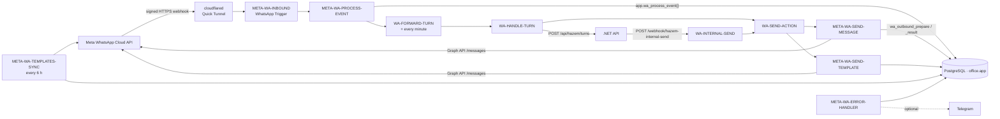

# WhatsApp integration (TASK 02 + TASK 03, n8n) — DECISIONS v1.3

n8n is the WhatsApp layer: the only part that talks to Meta. Business decisions belong to the
.NET API ([hazem-internal-api.md](hazem-internal-api.md)). Every rule that must hold (dedupe, 24-hour window, status order,
idempotent sending, template approval) lives in PostgreSQL functions in migration
`0002_whatsapp.sql`, so it runs in one transaction and is tested without Meta.

## Workflows (`n8n/workflows/`, imported with `n8n-import`)

| Workflow | Trigger | What it does |
|---|---|---|
| `META-WA-INBOUND` | WhatsApp Trigger | Verifies `X-Hub-Signature-256` with the App Secret, answers Meta's GET verification, registers the webhook when published. PROCESS-EVENT → WA-MEDIA-FETCH (media downloaded at once) → waits `group_quiet_seconds` + 1 s → WA-FORWARD-TURN. **One per Meta App.** |
| `META-WA-PROCESS-EVENT` | sub-workflow | Calls `app.wa_process_event(event)`: stores the event (dedupe by hash), messages (dedupe by `wamid`, `pending`; groups `ignored_group`), 24-hour window, delivery statuses (forward only), template status. No media download (TASK 03). |
| `META-WA-SEND-MESSAGE` | sub-workflow | Input `wa_id, text, idempotency_key, requested_by[, context_wamid][, interactive][, document]` (TASK 08: buttons or a list under the text, words from the API; TASK 10: `document {link, filename}` sends a document with `text` as its caption) → `{ ok, outbound_id, wamid, status, error_code, error_message }`. |
| `META-WA-SEND-TEMPLATE` | sub-workflow | Input `wa_id, template_name[, language=ar][, components], idempotency_key, requested_by` → same output. |
| `CFG-GET` | sub-workflow | Returns `app.settings` as `cfg`; stops if a required key is empty. |
| `META-WA-TEMPLATES-SUBMIT` | manual | Syncs, then submits the M-03 templates Meta does not have. Never resubmits or deletes. |
| `META-WA-TEMPLATES-SYNC` | every 6 h / manual / called | Pulls template status and category into `app.wa_templates`. |
| `META-WA-SUBSCRIPTION-CHECK` | manual | Shows the app's callback URL and fields; subscribes the WABA to the app if missing. Used by `tunnel-refresh`. |
| `META-WA-SUBSCRIPTION-DELETE` | manual | Deletes the app's webhook subscription. Used by `tunnel-refresh` / `tunnel-down`. |
| `META-WA-ERROR-HANDLER` | error workflow | Logs every failure to `app.workflow_errors` (long digit runs masked); Telegram nodes are disabled until `ops-telegram` exists. |
| `WA-FORWARD-TURN` | after INBOUND / every minute / manual | WA-MEDIA-FETCH first, then claims grouped turns (`app.wa_turns_claim`, max 20) and runs WA-HANDLE-TURN for each. The minute schedule retries turns given back while the API was down, stuck turns and media still waiting. |
| `WA-MEDIA-FETCH` | sub-workflow / manual | Claims up to 10 media rows (`app.wa_media_claim`) and runs WA-MEDIA-ONE for each. |
| `WA-MEDIA-ONE` | sub-workflow | One file: Graph API metadata → `app.wa_media_precheck` (size, allowed type, bucket, key) → download at once → sha256 (hex or base64) → S3 (`office-s3`) → `app.wa_media_stored`. Audio only, behind an explicit check (T-09): read back from S3 → OpenAI `/audio/transcriptions` (`openai-transcription`, `language=ar`) → `app.wa_media_transcribed`. The media URL is never stored. |
| `WA-HANDLE-TURN` | sub-workflow | One turn: `POST /api/hazem/turns`, sends every action through WA-SEND-ACTION, reports to `POST /api/hazem/send-results`, then `app.wa_turns_finish`. API down / 5xx / 401 / 403 → back to `pending`; 400 / 422 → `failed`. v1.39: first, the turn's last message is marked as read with Meta's typing indicator («بيكتب…», `status: read` + `typing_indicator`), never in dry run or through WAHA, and only to `whatsapp.test_recipients` while sends are restricted; a failure there never stops the turn. |
| `WA-SEND-ACTION` | sub-workflow | One action: `send_text`, `send_interactive` (TASK 08) or `send_document` (TASK 10) → SEND-MESSAGE, `send_template` → SEND-TEMPLATE, anything else → `INVALID_INPUT`. |
| `WA-INTERNAL-SEND` | Webhook `POST /webhook/hazem-internal-send` | Sends for the API (reminders, panel). Header `X-Hazem-Token` checked against credential `hazem-internal-send`; 403 otherwise. |
| `WA-TEST-HARNESS` | manual (`n8n execute`) | Runs fixtures through the real wiring without Meta (used by `wa-tests`). |
| `WAHA-INBOUND` | Webhook `POST /webhook/waha-inbound` | **TASK 02b, the WAHA test channel** (docs/runbooks/waha.md): WAHA's `message` / `message.ack`, header `X-Waha-Token` (`waha-webhook`), heard only while `whatsapp.provider` = `waha`; a LID → the number (WAHA); `app.waha_event` → Meta's event → PROCESS-EVENT → MEDIA-FETCH → quiet period → FORWARD-TURN. Published only when its credentials exist. |
| `WAHA-SEND` | sub-workflow | Called by SEND-MESSAGE (after `wa_outbound_prepare`) while the channel is WAHA: text, buttons / list as a numbered list (`app.waha_menus`), document → WAHA; `app.waha_sent` answers in Meta's shape. |
| `WAHA-MEDIA-ONE` | sub-workflow | WA-MEDIA-ONE for a `waha:` file: read from `waha.base_url` + its path with `waha-api`, sha256 computed here, then the same checks and storage. |

**TASK 02b:** `META-WA-SEND-MESSAGE` and `META-WA-SEND-TEMPLATE` read `whatsapp.provider` in `Prepare` and switch after
every rule (`WAHA?`): `meta` goes on to Meta exactly as before; `waha` → `WAHA-SEND` (a template is refused on WAHA).
`WA-MEDIA-ONE` hands a `waha:` file to `WAHA-MEDIA-ONE`. Nothing else of the Meta flow changed.

All workflows: timezone `Africa/Cairo`, error workflow `META-WA-ERROR-HANDLER`, successful
executions not saved (they contain customer data), failed ones kept (pruned after 14 days).

## Error codes

| Code | Meaning | Meta called? |
|---|---|---|
| `INVALID_INPUT` | bad `wa_id` (8–15 digits), empty/over-long text, missing key | no |
| `DUPLICATE` | same `idempotency_key` again: the first result is returned | no |
| `OUTSIDE_24H_WINDOW` | free-form text ≥ 24 h after the customer's last message (or Meta 131047) | no (local check) |
| `TEMPLATE_NOT_APPROVED` | template not `APPROVED` in `app.wa_templates` | no |
| `NOT_TEST_RECIPIENT` | 0006: `whatsapp.send_restricted` is `true` and the number is not in `whatsapp.test_recipients` (checked after the window and template rules) | no |
| `TOKEN_INVALID` | Meta 190: token expired/revoked; the workflow stops so the error handler alerts | yes |
| `RATE_LIMIT` | Meta 130429 / 131056 / 80007 / 4 | yes |
| `UNDELIVERABLE` / `RECIPIENT_NOT_ALLOWED` | Meta 131026 / 131030 (test number: recipient not in its list) | yes |
| `META_ERROR` / `NETWORK_OR_UNKNOWN` | other Meta error / timeout or no response | yes |

**Retries:** one retry after 3 seconds, only for HTTP 429/502/503/504. **No retry after a
timeout or HTTP 500**, because Meta may already have delivered the message; the result is
recorded as failed and the caller decides (with a new idempotency key if it really wants to resend).

## Tables (schema `app`)

`settings` (non-secret config), `wa_webhook_events`, `wa_inbound_messages` (TASK 03 reads
`pending`), `wa_contact_windows`, `wa_outbound_messages`, `wa_message_statuses`, `wa_templates`,
`workflow_errors`. Functions: `wa_process_event`, `wa_outbound_prepare`, `wa_outbound_result`
(executable by `office_app` only).

## Settings (`app.settings`, non-secret)

| Key | Value |
|---|---|
| `whatsapp.app_id` | Meta App ID |
| `whatsapp.waba_id` | WhatsApp Business Account ID |
| `whatsapp.phone_number_id` | phone number ID that sends |
| `whatsapp.graph_api_version` | `v26.0` (latest in Meta's changelog, 2026-10) |
| `whatsapp.test_recipients` | comma-separated `wa_id` list allowed on Meta's test number (digits only). **Migration 0006: while `whatsapp.send_restricted` is `true`, every send (Hazem, CLI, templates, later reminders and the panel) goes only to these numbers**; any other number is refused with `NOT_TEST_RECIPIENT` and never reaches Meta |
| `whatsapp.send_restricted` | `true` (0006). `false` = messages may go to any number: **the owner's explicit decision only** (CLAUDE.md); the healthcheck warns while it is `false` |
| `whatsapp.group_quiet_seconds` | `8`: a turn closes after this long without a new message from the client |
| `whatsapp.group_max_seconds` | `60`: a turn closes this long after its first message, and unfinished downloads/transcripts become `failed` (TIMEOUT) |
| `whatsapp.turn_stale_seconds` | `300`: a turn left `processing` (or a download left `downloading`) this long is taken again. Shorter only inside `hazem-e2e`; the healthcheck checks it |
| `whatsapp.media_max_mb` | `50`: larger files are not downloaded (`too_large`) |
| `whatsapp.graph_base_url` | `https://graph.facebook.com` (the test stub only during `hazem-e2e`) |
| `ai.openai_base_url` | `https://api.openai.com/v1` (the test stub only during `hazem-e2e`) |
| `ai.transcription_model` | `whisper-1`: a documented default, **to be confirmed by the owner on real Egyptian voice notes (T-08)** |
| `whatsapp.dry_run` | `false`. `true` only during `hazem-e2e`: sends are recorded as sent (`wamid.DRYRUN-…`) without calling Meta. The healthcheck fails while it is `true` |
| `ops.telegram_chat_id` | optional, for alerts |

Set them with SQL as the superuser, for example:
`UPDATE app.settings SET value = '<id>', updated_by = 'owner' WHERE key = 'whatsapp.app_id';`
Secrets never go here (a CHECK constraint rejects secret-looking keys); they live in n8n Credentials.

## Credentials (n8n)

| Name | Type | Created by |
|---|---|---|
| `office-postgres-app` | Postgres (`office_app`) | `n8n-import` (from `.env`) |
| `hazem-api` | Header Auth `X-Hazem-Token` = `HAZEM_API_TOKEN` | `n8n-import` (from `.env`) |
| `hazem-internal-send` | Header Auth `X-Hazem-Token` = `N8N_INTERNAL_SEND_TOKEN` | `n8n-import` (from `.env`) |
| `office-s3` | S3 (Garage `http://garage:3900`, path style, n8n key `S3_N8N_*`: office-media and office-sensitive only) | `n8n-import` (from `.env`) |
| `openai-transcription` | Header Auth (`Authorization: Bearer …`) | project owner only (docs/meta-setup.md 3.4). Without it voice notes reach the API with `transcript.status = failed` |
| `meta-whatsapp-trigger` | WhatsApp OAuth API (App ID + App Secret) | project owner (docs/meta-setup.md) |
| `meta-whatsapp-token` | Header Auth (`Authorization: Bearer …`) | project owner |
| `meta-app-token` | Query Auth (`access_token = AppID|AppSecret`) | project owner |
| `ops-telegram` | Telegram | project owner, optional |

## Grouping messages into turns (TASK 03)

- A turn is every waiting message of one client once the client has been quiet for
  `group_quiet_seconds` (8), or `group_max_seconds` (60) after the first message, with all
  media final and voice notes transcribed. At the 60-second limit, unfinished downloads and
  transcripts are marked `failed` (TIMEOUT) **in the same transaction**, and a download that
  finishes later is refused (`wa_media_stored` → false) and its file removed.
- All time rules use `received_at` (our clock), never `sent_at` (Meta's; it can be late or out
  of order). `sent_at` only orders the messages inside a turn.
- Ordering: a client has at most one open turn (partial unique index on `app.wa_turns`). A turn
  given back after an API failure is retried first with the same `turn_id` and messages.
- **Lock: PostgreSQL, not Redis.** The messages and turns live in PostgreSQL, so the per-client
  lock (`pg_try_advisory_xact_lock`) is taken and released in the same transaction that assigns
  the messages: no state where one side changed and the other did not. A locked client is
  skipped (never waited for), so the inbound path and the every-minute schedule can run at the
  same time without blocking or double-claiming. Redis stays for later needs (rate limiting).
- The quiet wait happens in META-WA-INBOUND (Wait node, its length read from
  `group_quiet_seconds`); the minute schedule is the safety net (restarts, late media).

## Media buckets (TASK 03, fixed safety rule, not a business decision)

| Kind | Bucket | Why |
|---|---|---|
| image, document | `office-sensitive` | may be an ID card, Urfi papers, a receipt or a contract; n8n cannot (and must not) know |
| audio, video, sticker | `office-media` | |

Key: `wa/<yyyy>/<mm>/<media row id>.<ext>` (Cairo month of `received_at`). Allowed types: JPEG,
PNG, WebP, HEIC, PDF, Word, Excel, PowerPoint, plain text, OGG/MP3/M4A/AAC/AMR audio, MP4/3GP
video; anything else is `rejected` and never stored. The content type is the object's
Content-Type. Videos are stored but not transcribed.

## Test stub (`meta-stub`, docker compose profile `tests`)

`backend/tests/Office.TestStub`: a small .NET app that answers like Graph API media
(`GET /{version}/{media_id}`, `GET /files/{id}`) and OpenAI transcription
(`POST /v1/audio/transcriptions`), with fixed files (JPEG, PDF, OGG, a wrong sha256, a 70 MB
announcement, an executable). It records what it received — whether an Authorization header
was present, never its value. Only `hazem-e2e` starts it and points the two base URLs at it.

## Known limits

- **Quick Tunnel (D-5):** the URL changes on every tunnel/Docker/PC restart → `tunnel-refresh`.
  Events Meta sends while the tunnel is down are retried by Meta for a limited time, then lost.
- **One Meta App = one callback URL** (one WhatsApp Trigger). Production needs its own app.
- **Invalid signatures** are rejected inside the trigger and produce no execution (no counter).
- **Documents we send (TASK 10)** go to Meta as a link (`document.link`), so Meta must reach it: Garage in
  test is not public, so a real delivery waits for R2 (`S3__PublicEndpoint`, TASK 14). Dry run stores the
  payload without sending.

## Reference used for TASK 03: n8n template 17216

Reviewed on 2026-10-20 ("multimodal WhatsApp AI assistant"). Reuse:
- **Media download in two steps:** `GET /{graph_version}/{media_id}` returns a short-lived `url`;
  download it with the same Bearer token (`meta-whatsapp-token`). Do it right away: the URL expires in minutes.
- **Switch by message type** (text / audio / image / document / other) and a polite
  "unsupported type" reply.
- **Voice transcription** with OpenAI audio; normalise the MIME type first
  (WhatsApp voice notes are `audio/ogg; codecs=opus`; the template maps `audio/mp3` → `audio/mpeg`).

Do **not** reuse: image analysis with OpenAI Vision and PDF text extraction to the AI (T-09: ID cards,
receipts and contracts never go to an AI provider), the free-form AI Agent reply (T-07: replies come
from approved texts), in-memory chat memory, text-to-speech and image generation. Also note the
template reads only `messages[0]`; our processing handles every message in an event.
